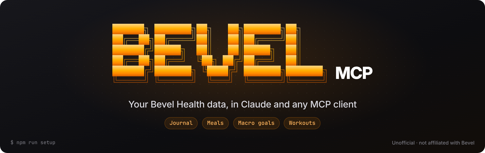
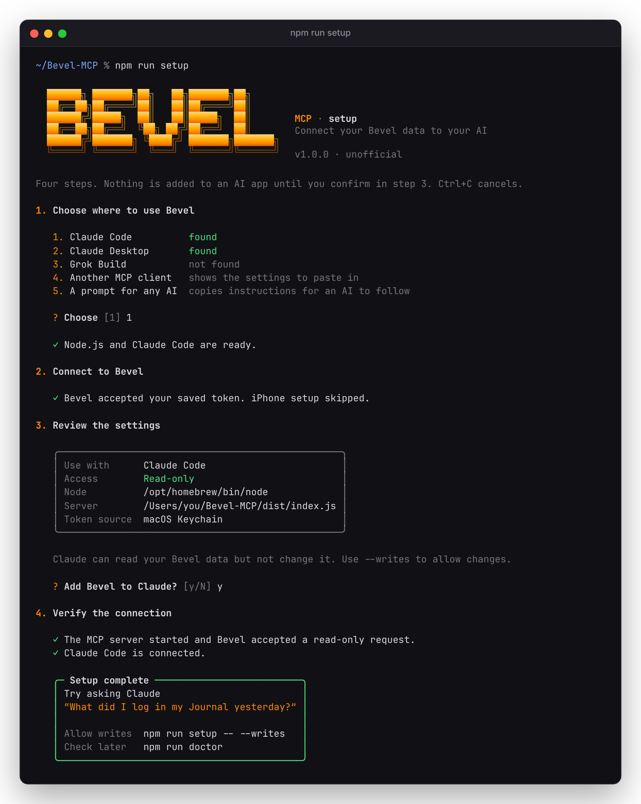
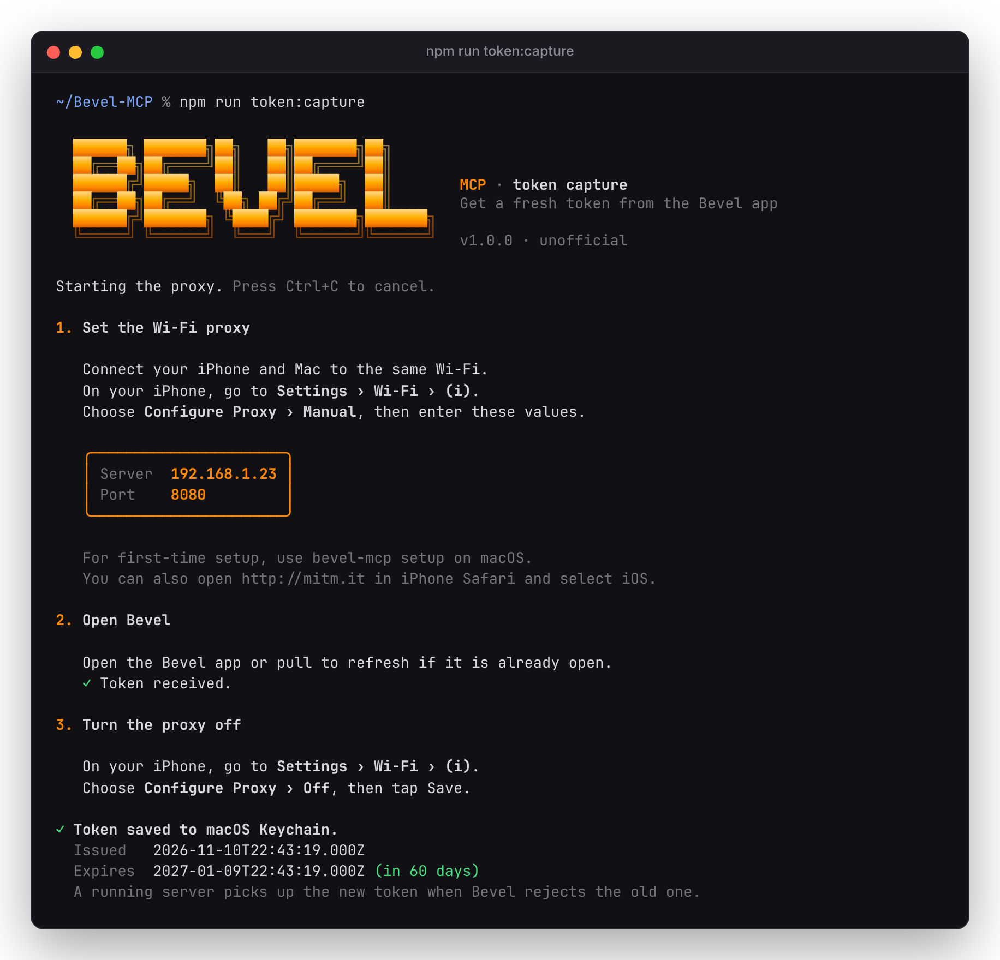

<p align="center">
  
</p>

<p align="center">
  <a href="https://github.com/JoshPopov/Bevel-MCP/actions/workflows/ci.yml"></a>
  
  
  <a href="LICENSE"></a>
</p>

An [MCP](https://modelcontextprotocol.io) server for **Bevel Health**. Ask Claude, Grok Build or any
MCP client about your Journal, meals, macro goals and workouts, and log new ones.

> [!WARNING]
> **Unofficial.** This project isn't affiliated with Bevel. It uses Bevel's private API,
> reverse-engineered from the iOS app, so it can break whenever Bevel changes it. Use it only with
> your own account.

## Quick start

You need a Mac with Node.js 20+, the Bevel app on your iPhone, and
[mitmproxy](https://mitmproxy.org) (`brew install mitmproxy`) to get your first token.

```bash
git clone https://github.com/JoshPopov/Bevel-MCP.git && cd Bevel-MCP
```

```bash
npm ci && npm run setup
```

<p align="center"></p>

Setup gets a token from your iPhone and shows what it will change. It asks before changing anything,
then checks that the server answers and that Bevel accepts a real request. After that, try:

- “What did I log in my Journal yesterday?”
- “How much protein have I had today compared with my goal?”
- “How has my leg press changed this month?”
- “Log a banana as a snack at 3pm.” *(needs writes)*

| Use with | `--client` | What setup does |
|---|---|---|
| Claude Code | `code` | Adds a user-scope `bevel` server and checks that it's connected |
| Claude Desktop | `desktop` | Adds `bevel` and keeps your other servers |
| Grok Build | `grok` | Runs `grok mcp add` (the Grok app and Grok Bot can't reach local servers) |
| Any MCP client | `other` | Shows and copies the JSON config |
| Any AI agent | `prompt` | Copies a prompt telling the agent how to add the server |

Writes are off by default. Turn them on with `npm run setup -- --writes` and off with `--read-only`.
`npm run doctor` checks a Claude setup and prints a report you can share.

## Tools

| Area | Read | Write |
|---|---|---|
| Journal | `get_journal`, `get_custom_journal_types`† | `set_journal_boolean`, `clear_journal_boolean`† |
| Meals | `search_food`, `get_food_logs` | `log_food`, `update_food_log`†, `delete_food_log`† |
| Macro goals | `get_macro_goals` | `set_macro_goals` |
| Workouts | `get_workout_data`, `get_workout_history` | `save_routine`, `delete_routine`, `create_custom_exercise`† |
| Account | `auth_status` | |

Every tool name starts with `bevel_`. † These requests come from the app's own traffic but haven't
been run against a real account yet.

Every write supports `dryRun`, reads fresh data first, and succeeds only when Bevel confirms the
record.

**Not supported:**
- Logging completed workouts (they belong to Apple Health).
- Sleep, Strain and Recovery scores (Bevel calculates them on the iPhone).
- Cardio, custom foods and recipes.
- Number and choice Journal factors.

[Tool details](docs/GUIDE.md#tools)

## Your token

Bevel signs you in with a token that lasts 60 days. Sign in with Apple can't be repeated from a
computer, so `npm run token:capture` takes the token from the Bevel app's own requests through a
local proxy. It checks the token with Bevel, then saves it to the macOS Keychain.

<p align="center"></p>

- Capture installs a certificate on your iPhone that lets your Mac read Bevel's traffic. Remove it in
  **Settings › General › VPN & Device Management** when you're done.
- The proxy intercepts only `api.supersethealth.com`, records nothing, and never prints the token.
- `npm run status` shows how many days are left. To renew, run `npm run token:capture` again; your
  Claude setup doesn't change.

[Token details and the first-time iPhone steps](docs/GUIDE.md#your-token)

## Privacy

- Your data travels only between your Mac, Bevel's API and the AI app you connect. There's no
  telemetry and no other server.
- The token stays in your Keychain and is redacted from logs and errors.
- Never share a token, an `Authorization` header or a raw capture. A `doctor` report is safe to share.
  See [SECURITY.md](SECURITY.md).

## Docs

- [Guide](docs/GUIDE.md): token, settings, connecting clients by hand, how writes behave, troubleshooting, reset
- [Development](docs/DEVELOPMENT.md): tests, live checks against your account, mapping more of the API
- [API notes](docs/API_NOTES.md): every endpoint and payload seen so far
- [Changelog](CHANGELOG.md)

## License

[MIT](LICENSE). Bevel and Bevel Health belong to their owners. This project isn't affiliated with or
endorsed by them.
