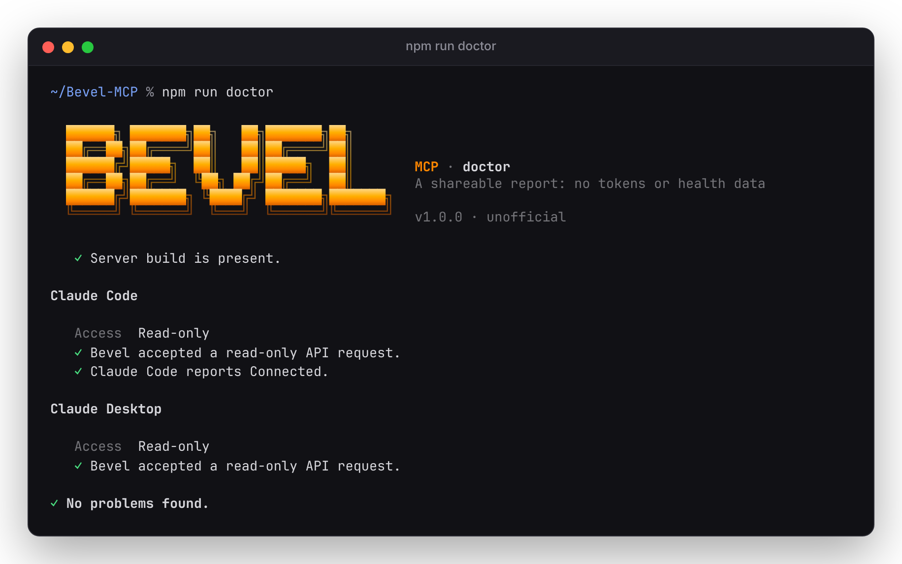

# Guide

- [Tools](#tools)
- [Your token](#your-token)
- [Settings](#settings)
- [Connecting clients by hand](#connecting-clients-by-hand)
- [How writes behave](#how-writes-behave)
- [Troubleshooting](#troubleshooting)
- [Starting over](#starting-over)

## Tools

| Area | Tool | What it does | Status |
|---|---|---|---|
| Account | `bevel_auth_status` | Token source, account (masked), expiry. With `checkApi`, confirms Bevel accepts the token. | Live |
| Journal | `bevel_get_journal` | Yes/no entries as `{day, factorKey, value}`, filterable by date and factor | Live |
| Journal | `bevel_set_journal_boolean` | Sets a factor for a day, updating that day's entry in place like the app does | Live |
| Journal | `bevel_clear_journal_boolean` | Clears a factor for a day (shows as not answered) | Request captured |
| Journal | `bevel_get_custom_journal_types` | Your custom Journal types | Envelope captured |
| Goals | `bevel_get_macro_goals` | Calorie and macro goals, marking the active one | Live |
| Goals | `bevel_set_macro_goals` | New goals from today; ends the old goal like the app does | Live |
| Meals | `bevel_search_food` | Bevel's food database, with per-serving nutrients | Live |
| Meals | `bevel_log_food` | Logs a food at a time with N servings | Live |
| Meals | `bevel_get_food_logs` | A day's foods with nutrients and totals | Live |
| Meals | `bevel_update_food_log` / `bevel_delete_food_log` | Change servings or time, or delete a log | Request captured |
| Workouts | `bevel_get_workout_data` | Routines (exercises, sets) and custom exercises | Live |
| Workouts | `bevel_get_workout_history` | Completed workouts: date, duration, effort, sets × reps × weight, volume | Live, read-only |
| Workouts | `bevel_save_routine` / `bevel_delete_routine` | Create, replace or delete a strength routine | Live |
| Workouts | `bevel_create_custom_exercise` | Create a custom exercise | Request captured |

**Live** means the tool has run against a real account. **Request captured** means the exact request
was seen in the app's own traffic, but the tool hasn't run against a real account yet.

**Not supported:**
- **Logging completed workouts:** each one is linked to an Apple Health workout, which this server can't create.
- **Sleep, Strain and Recovery scores:** Bevel calculates them on the iPhone and never sends them to its API.
- Cardio and exercise notes.
- Number and choice Journal factors, and custom Journal factors.
- Custom foods and recipes. Branded foods are logged without the brand name.
- Renewing the token without the iPhone.

## Your token

Bevel issues a 60-day token when you sign in. Sign in with Apple can't be repeated from a computer,
so `token capture` takes the token from the Bevel app's own requests.

```bash
npm run token:capture
```

1. The command starts the capture proxy and prints your Mac's address and port. On the iPhone, open
   **Settings › Wi-Fi › (i) › Configure Proxy › Manual** and enter them.
2. Open Bevel, or pull to refresh.
3. When asked, set the iPhone proxy back to **Off**. The command checks the token with Bevel, then
   saves it to the Keychain (service `bevel-mcp`, account `token`) and shows when it expires.

How it handles the token:
- The proxy has its own configuration in `~/.config/bevel-mcp/proxy`. It records no traffic and
  intercepts TLS only for `api.supersethealth.com`.
- It saves only a well-formed, unexpired token that Bevel accepts.
- Parts of the app can send an older token, so it waits a few seconds after the first one and keeps
  whichever **expires last**.
- It keeps a working saved token that expires later. Switching accounts, or replacing a working token
  with one that expires sooner, needs `--force`.
- Options: `--port N` (default 8080), `--timeout S` (default 300), and `--file PATH` to save to a file
  instead of the Keychain.

**Renewal:** `npm run status` shows the days left. Run `npm run token:capture` to renew; no client needs
reconfiguring, because a running server rereads its token when Bevel rejects the old one. If you use a
token file, renew into it with `--file PATH`.

**Fallback:** if you copied the `Authorization` value yourself, `npm run token:set` checks it, saves it
and clears the clipboard.

### First-time iPhone setup

`npm run setup` makes an iPhone profile from the capture proxy's certificate and shows it in Finder.
1. Right-click **Bevel Capture Certificate.mobileconfig**, choose **Share › AirDrop**, and send it to
   your iPhone.
2. Open **Settings › Profile Downloaded** and install **Bevel Capture Certificate**.
3. Open **Settings › General › About › Certificate Trust Settings** and turn on full trust for
   **mitmproxy**.

On later runs, type **S** at the certificate prompt to skip these steps. The Bevel proxy uses its own
certificate, separate from a default mitmproxy install. A phone that trusted mitmproxy before still
needs this profile once, and can then remove the old one in **Settings › General › VPN & Device
Management**. To stop using capture, remove the Bevel profile from the iPhone and delete
`~/.config/bevel-mcp/proxy` on the Mac.

### Token sources

On macOS the server reads the Keychain item by default. Elsewhere, or to override it, set one of these
variables. The first one that's set wins:

| Variable | Notes |
|---|---|
| `BEVEL_TOKEN` | The token itself. Simplest, but it sits in plain text in your MCP config. |
| `BEVEL_TOKEN_FILE` | A file containing the token (`chmod 600`). `token capture --file` writes one. |
| `BEVEL_TOKEN_COMMAND` | Any command that prints the token. The macOS default is `/usr/bin/security find-generic-password -s bevel-mcp -a token -w`. |

## Settings

Set these as environment variables in your MCP client's config, or as `serve` arguments:

| Variable | `serve` argument | Default | Meaning |
|---|---|---|---|
| `BEVEL_ENABLE_WRITES` | `--writes`, `--read-only` | `false` | Write tools refuse to run unless this is `true`. `dryRun` always works. |
| `BEVEL_TOKEN_FILE` | `--file PATH` | | Read the token from a file. |
| `BEVEL_TIMEZONE` | `--timezone TZ` | your computer's | Turns dates into Bevel's day timestamps (local noon). |
| `BEVEL_APP_VERSION` | `--app-version V` | `3.2.7` | If Bevel asks for a newer app, set this to the version shown in the app. |
| `BEVEL_CACHE_SECONDS` | | `60` | Reuse reads within a session. `0` turns this off. Writes always read fresh data. |
| `BEVEL_LOG_LEVEL` | | `info` | `error`, `warn`, `info` or `debug`. Logs go to stderr with secrets redacted. |
| `BEVEL_USER_AGENT` | | `bevel-mcp/<version>` | Override only if the API starts requiring the app's User-Agent. |
| `BEVEL_BASE_URL` | | `https://api.supersethealth.com` | Must be https, except for localhost. |

The terminal commands use colour, the logo and spinners in an interactive terminal. Piped output is
plain text. `NO_COLOR=1` turns colour off everywhere.

## Connecting clients by hand

It's a stdio server. Your MCP client starts it with a command and arguments:

```bash
node /Users/you/Bevel-MCP/dist/index.js serve --writes
```

Use absolute paths, because some apps start with a minimal `PATH`. `which node` shows yours. To try the
server without an AI app:

```bash
npx @modelcontextprotocol/inspector node "$(pwd)/dist/index.js" serve
```

**Claude Code** (what `npm run setup -- --client code` does):

```bash
claude mcp add bevel --scope user -e BEVEL_ENABLE_WRITES=false -- node "$(pwd)/dist/index.js"
```

**Claude Desktop:** add this to `~/Library/Application Support/Claude/claude_desktop_config.json`, then
quit and reopen the app:

```json
{
  "mcpServers": {
    "bevel": {
      "command": "/opt/homebrew/bin/node",
      "args": ["/Users/you/Bevel-MCP/dist/index.js"],
      "env": { "BEVEL_ENABLE_WRITES": "false" }
    }
  }
}
```

**Grok Build:**

```bash
grok mcp add bevel -- /opt/homebrew/bin/node /Users/you/Bevel-MCP/dist/index.js serve
```

The first time the server reads the Keychain, macOS may ask for permission. Choose **Always Allow**.

## How writes behave

**All writes:**
- A write succeeds only when Bevel lists the record's id as `succeeded`. HTTP 200 alone isn't enough.
- Writes are never retried automatically.
- Every write reads fresh data first. If the data has a shape the tool doesn't recognise, it writes
  nothing and shows a token-free sample instead.

**Journal:**
- The app keeps **one entry per factor per day**, and so does the tool. It updates that day's entry
  in place (same `uuid` and `createdAt`), creates one if there's none, and does nothing if the value
  is already set. Rerunning after a dropped connection is safe.
- Clearing keeps the entry. It sets `isNotSet: true` and drops `boolValue`, as the app does.
- Known factor keys are `addedSugar`, `deviceInBed` and `lateMeal`. Any other key needs
  `allowUnverifiedFactorKey: true`.

**Meals:**
- Bevel files a food under breakfast, lunch or dinner **by its time**; there's no meal field.
- Edits and deletes keep the same id. A delete is a soft delete (`deletedAt`).

**Goals:** a change ends the current goal yesterday and starts a new one today. A second change on the
same day updates it in place.

**Workouts:**
- Routines are sent whole.
- Exercise ids, equipment and muscle groups must already appear in captures or your own data;
  otherwise pass `allowUnverifiedValues: true`. An unknown value could break the app.
- Supersets aren't written yet. Replacing a routine that has them needs `allowDroppingSupersets: true`.
- kg weights are stored the way the app stores them (kg × 2.20462).

After a write, force-quit Bevel and reopen it to see the change.

## Troubleshooting

Start with `npm run doctor`. Its report has no tokens or health data, so it's safe to share.

<p align="center"></p>

| Message | What to do |
|---|---|
| "Bevel rejected the token" | It expired or was revoked. Run `npm run token:capture`. |
| "Bevel may require a newer app version" | Set `BEVEL_APP_VERSION` to the version shown in the Bevel app and restart your client. |
| "…has a shape this client does not recognise" | Bevel may have changed its API. Open an issue with the `doctor` or default live-check summary. |
| `token capture`: "No request from the Bevel app…" | Check the iPhone proxy (Mac address and port) and certificate trust, and that both devices are on the same Wi-Fi. |
| `token capture`: "Address already in use" | Quit `mitmweb`/`mitmdump`, or use `--port 8081`. |
| "Claude Code did not report Connected" | Run `claude mcp get bevel` in the project where you use it. Check for another entry with the same name, then restart the Claude session. |
| "Claude Code's status could not be read" | Setup already started the server and made a Bevel request, so it works. Check `claude mcp list`. |
| "Claude Code already has a different user-scope bevel entry" | Setup didn't write that entry. Check it with `claude mcp get bevel`, remove it with `claude mcp remove bevel --scope user`, then rerun setup. |
| "Grok Build could not add Bevel" | If Bevel is already there, remove it in Grok Build, then rerun setup. |
| `git pull` blocked by `package-lock.json` | Run `git checkout -- package-lock.json`, then use `npm ci`. |

## Starting over

To run setup as a new user would, remove what it left behind.

**On the Mac:**
1. Run `claude mcp remove bevel --scope user`. For Claude Desktop, delete the `bevel` entry from its
   config file and restart the app.
2. Run `security delete-generic-password -s bevel-mcp -a token` to delete the Keychain token.
3. Run `rm -rf ~/.config/bevel-mcp` to remove the proxy certificate and any token file.

**On the iPhone:** remove **Bevel Capture Certificate** in **Settings › General › VPN & Device
Management**, and check that the Wi-Fi proxy is **Off**.
